  

  
  

I build software for regulated money flows: e-invoicing (UBL-TR), payment and banking integrations, ledgers and reconciliation.
My background combines hands-on engineering with enterprise sales of financial software, so I design systems that are both technically correct and operable by finance teams.

## What I work on

<table>
  <tr>
    <td width="50%" valign="top">
      <h4>🏦 Open Banking</h4>
      TCMB &amp; BKM ÖHVPS 2.0.1 (GEÇİT), HBH (Account Information), ÖEH (Payment Initiation), FAST, Kolas, detached JWS (RFC 7515 / 7797)
    </td>
    <td width="50%" valign="top">
      <h4>🧾 E-Transformation</h4>
      UBL-TR 2.1, e-Fatura / e-Arşiv / e-İrsaliye data models and validation
    </td>
  </tr>
  <tr>
    <td valign="top">
      <h4>💳 Payments &amp; Banking</h4>
      IBAN, statement parsing, reconciliation, idempotent webhook processing
    </td>
    <td valign="top">
      <h4>📒 Ledgers</h4>
      Double-entry accounting, integer money arithmetic, audit trails
    </td>
  </tr>
  <tr>
    <td valign="top">
      <h4>🤖 AI Tooling</h4>
      Terminal agents, multi-provider key pooling, MCP, Orca/Electron integration
    </td>
    <td valign="top">
      <h4>🧱 Full-Stack</h4>
      TypeScript, Node.js, Next.js, Python, PostgreSQL, Redis, Docker
    </td>
  </tr>
</table>

## Portfolio

  
  
  
  
  
  
  
  
  
  

## Tech stack

| Domain | Technologies |
| :--- | :--- |
| Languages |      |
| Backend |      |
| Frontend |    |
| Data |      |
| Quality & DevOps |      |

## GitHub activity

  
  

<!-- Banner and project cards are generated by `node scripts/build-assets.mjs`. -->
